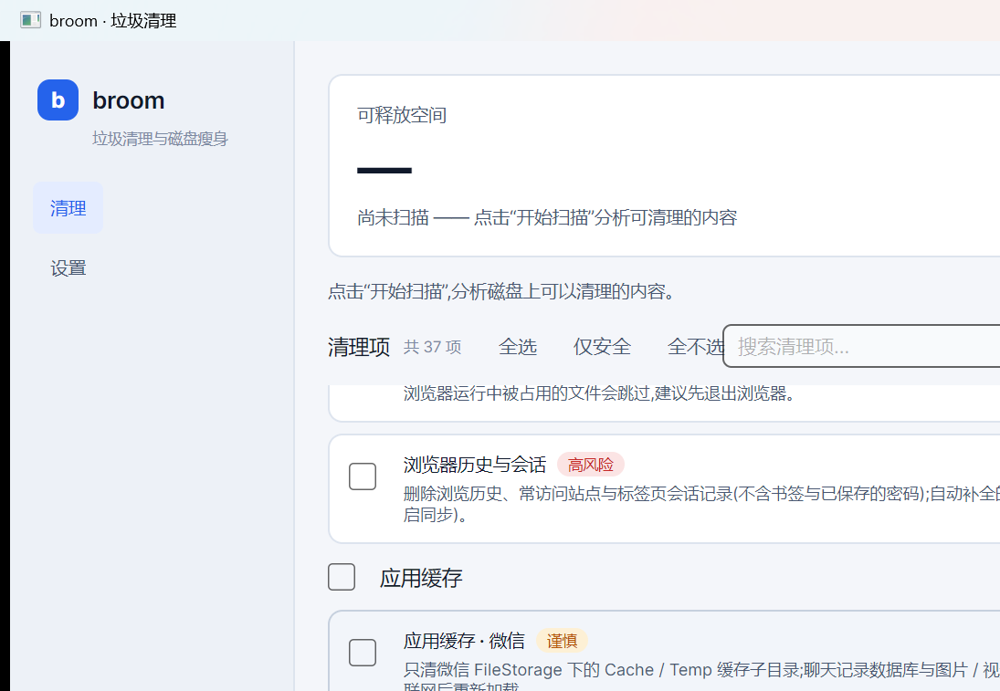

# broom


Windows 磁盘清理工具:把「什么是垃圾」写成纯数据规则,先扫描预览、再按需清理。基于 .NET 10 + [Avalonia](https://avaloniaui.net/) 构建,支持深浅色双主题。



## 功能特性

- **声明式清理规则**:41 条内置规则覆盖系统垃圾、浏览器、应用缓存、开发者缓存等类目,含事件日志 / DNS / 还原点与卷影 / WinSxS 等「动作型」清理;规则是纯数据([Rules/WindowsRuleSet.cs](Rules/WindowsRuleSet.cs)),路径模板支持 `%ENV%` 展开与目录名通配符
- **先看后删**:扫描只读,清理前可展开文件明细、按大小筛选、排除单个文件或整个目录;排除项持久化并自动去重校验
- **可控删除**:删除方式可选回收站 / 永久删除;可选「跳过最近 N 天内修改过的文件」;可选安全擦除(删除前用随机数据覆写);可选清理后回收扫描根下的空目录(默认关闭)
- **可回退**:永久删除先进隔离区,可按会话还原;被占用文件可登记「重启后删除」;清理前可自动创建系统还原点
- **看得懂的报告**:报告含各盘可用空间前后对比(实际释放了多少),一键复制;扫描明细可导出 CSV / TXT 核对;勾选状态跨会话记忆
- **随时中止**:扫描 / 清理支持取消,取消时仍产出部分清理报告
- **管理员提权**:系统目录类规则标记「需要管理员权限」,可在应用内一键重启提权
- **规则管理**:自定义清理目录(含包含 / 排除模式)、搜索、风险筛选、排序,分组展示
- **命令行 / 无人值守**:`broom --scan|--clean [safe|all] --dry-run --report out.txt --yes`,约定退出码,可接入 Windows 计划任务或脚本
- **自动化与托盘**:每周 / 每月 / 每天定时自动清理(范围可预期:仅安全项或上次勾选,一律走回收站),托盘常驻、可关闭窗口后继续运行;磁盘可用空间低于阈值时弹出提醒
- **清理历史**:每次清理(含自动清理与命令行)计入 `%APPDATA%\broom\history.json`,界面展示「本次释放 / 累计释放」与最近记录
- **中英双语**:文案跟随系统语言(中文系统显示中文,其余显示英文);界面、规则、报告与命令行输出全部本地化,资源见 [Localization](Localization/Strings.resx)

## 构建与运行

要求:**Windows 10/11** 与 [.NET 10 SDK](https://dotnet.microsoft.com/download)。

```powershell
dotnet run                      # 开发运行(默认普通权限)
dotnet build -c Release         # 构建
dotnet test broom.slnx          # 全量单元测试
dotnet publish -c Release       # 发布(打包分发方案见 backlog 第 19 项)
```

默认以普通权限运行;清理系统目录(如 `C:\Windows\Temp`、Prefetch)需要管理员权限,清理失败时应用会提示一键重启提权。

## 命令行与自动化

不启动界面直接跑扫描 / 清理(同一套引擎与设置,排除项、时间过滤、隔离区行为与界面一致):

```powershell
broom --scan --report scan.txt            # 只读扫描并把报告存为文件
broom --clean safe --dry-run              # 预演:按“仅安全项”扫描并输出报告,不删除
broom --clean safe --yes --report clean.txt   # 无人值守清理安全项(计划任务 / 脚本用)
broom --clean all --yes                   # 清理全部规则(含谨慎与高风险,不可逆类目也会执行)
```

- `--clean [safe|all]`:`safe`(默认)只清安全项;`all` 含谨慎与高风险项 —— 不可逆类目会真正执行,请确认后再用
- `--yes` 必须显式给出才会跳过确认;缺少时会提示 `[y/N]`,拒绝或无输入即取消
- 退出码:`0` 成功;`1` 有失败项或运行错误;`2` 参数错误;`3` 未确认或被取消
- 接入 Windows 计划任务示例:`schtasks /create /tn "broom auto clean" /sc weekly /tr "broom.exe --clean safe --yes --report %APPDATA%\broom\auto-clean.txt"`

界面内可开启定时自动清理(设置 → 自动化与托盘):每天 / 每周 / 每月到点执行,范围为仅安全项或上次勾选的项目,一律移入回收站(不永久删除),结果计入清理历史并弹出通知。自动清理只在 broom 运行时执行;关闭主窗口默认最小化到托盘保持常驻,托盘菜单可「立即清理」或真正退出。

## 清理规则总览

风险等级决定默认勾选与提示强度:**安全** = 可放心删除、默认勾选;**谨慎** = 删除后需重建 / 重新下载、默认不勾选;**高风险** = 删除后不可逆、默认不勾选(可在设置中隐藏整个高风险类目)。

| 类别 | 规则 | 风险 |
|---|---|---|
| 系统临时与日志 | 用户临时文件、系统临时文件、应用崩溃转储、系统内存转储、Windows 错误报告(用户 / 系统)、Windows 组件日志、系统升级残留与安装日志、Windows 事件日志(动作) | 安全(前 6 项默认勾选)/ 谨慎 / 高风险 |
| 系统缓存 | Internet 临时文件、缩略图与图标缓存、字体缓存(用户 / 系统)、Windows 更新下载缓存、预读取文件、传递优化文件、DNS 解析缓存(动作,默认勾选) | 安全 / 谨慎 |
| 使用痕迹 | 最近使用的文档与跳转列表 | 谨慎 |
| 浏览器缓存 | Chrome / Edge / Brave / Opera / Vivaldi / 360 / QQ 浏览器 / Firefox 的网页缓存 | 谨慎 |
| 浏览器隐私 | Cookie 与登录状态、历史与会话 | 高风险 |
| 应用缓存 | 微信、QQ、钉钉、Teams / Discord / Slack、Office / OneDrive、Spotify、商店应用(UWP) | 谨慎 |
| 开发者缓存 | NuGet、npm、pip、Yarn、pnpm、Gradle、Maven、Go、Cargo | 谨慎 |
| 自定义目录 | 设置页自行添加,含包含 / 排除模式 | 自选 |
| 回收站 | 清空回收站 | 谨慎 |
| 系统备份 | 旧系统备份与升级残留(Windows.old 等)、旧还原点与卷影副本(动作)、组件存储清理 WinSxS(动作) | 高风险 |

### 安全说明

- **聊天类只清缓存子目录**:微信 / QQ 仅扫描 `FileStorage\Cache|Temp`,钉钉仅清表情 / 头像 / 聊天图片缓存;聊天记录数据库与图片 / 视频 / 文件原目录不在扫描范围内
- **浏览器隐私独立成组**:Cookie / 历史清理默认不勾选,描述中明确后果(登录状态丢失、历史不可恢复);已保存的密码永不触碰
- **高风险类目**默认不勾选:删除 `Windows.old` 后无法回滚系统;清空回收站、清除浏览器隐私均不可恢复
- **动作型清理**:事件日志清空、还原点 / 卷影删除(每卷保留最新一个)、WinSxS 组件清理均为不可逆动作 —— 高风险、默认不勾选、需管理员权限;DNS 缓存刷新无副作用
- **安全擦除有限性**:机械硬盘上可降低恢复可行性;SSD 与写时复制文件系统上效果有限
- 扫描是只读操作;实际删除只发生在点击「清理」之后

## 数据与配置位置

| 内容 | 位置 |
|---|---|
| 设置(自定义目录、排除规则、默认选项、自动化) | `%APPDATA%\broom\settings.json` |
| 清理历史与累计统计(含自动清理 / 命令行) | `%APPDATA%\broom\history.json`,最多保留 500 条 |
| 隔离区(永久删除暂存、可还原) | `%LOCALAPPDATA%\broom\quarantine`,按清理会话分目录,按保留天数自动清理 |
| 重启后删除登记 | 由系统在下次启动时处理,无需人工干预 |

## 项目结构

```
Core/       规则与数据模型、路径模板展开、格式化、清理历史
Rules/      Windows 内置规则集(纯数据)
Services/   扫描器、清理器、设置与历史持久化、清理工作流、自动清理与磁盘看门通知
Cli/        命令行模式:参数解析与无人值守执行
Localization/ 文案资源(中性中文 + 英文)与 AXAML 引用扩展
Platform/   Windows 能力:回收站、提权、隔离区、重删、还原点、安全擦除
ViewModels/ MVVM 视图模型(CommunityToolkit.Mvvm)
Styles/     主题变量与控件样式(深浅色双主题)
broom.Tests/ xUnit 单元测试
docs/       roadmap(已设计 / 已实现)与 backlog(未实现清单)
```

## 文档

- [docs/roadmap.md](docs/roadmap.md) —— 各功能的背景、方案、影响文件与验收标准(含实现记录)
- [docs/backlog.md](docs/backlog.md) —— 未完成功能清单与建议推进顺序

每项改动均配套单元测试,CI 在 `windows-latest` 上执行构建 + 全量测试([.github/workflows/ci.yml](.github/workflows/ci.yml))。
